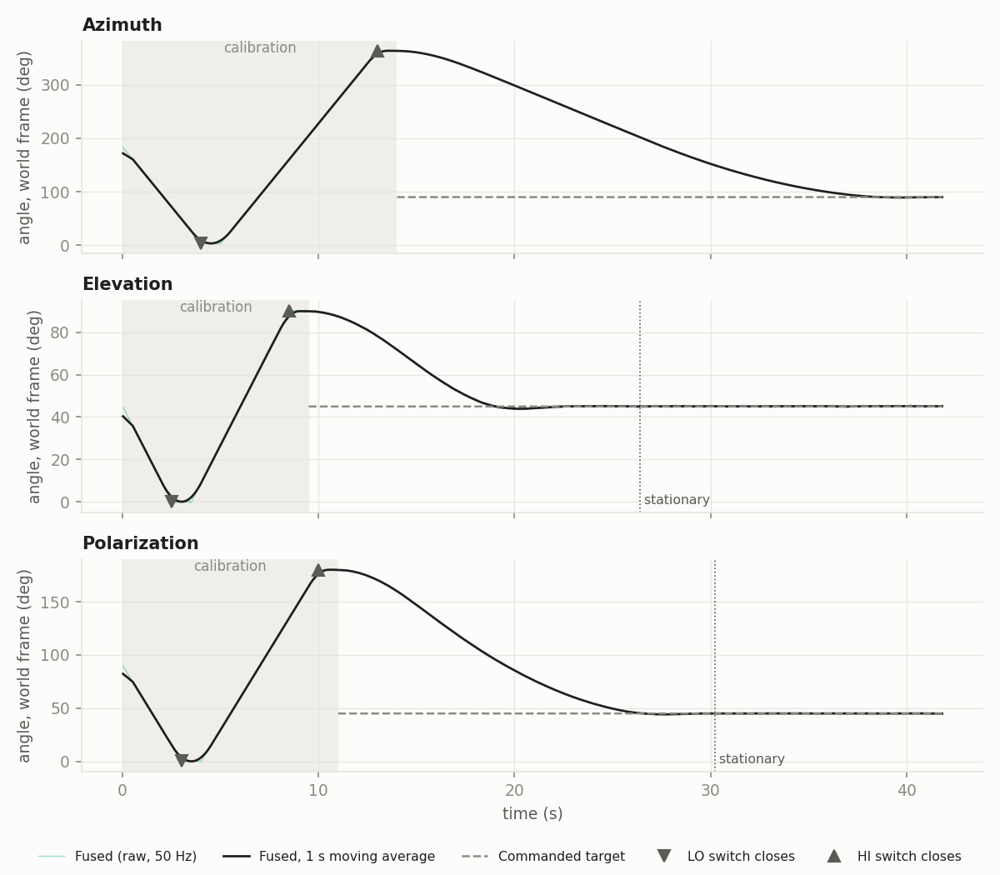
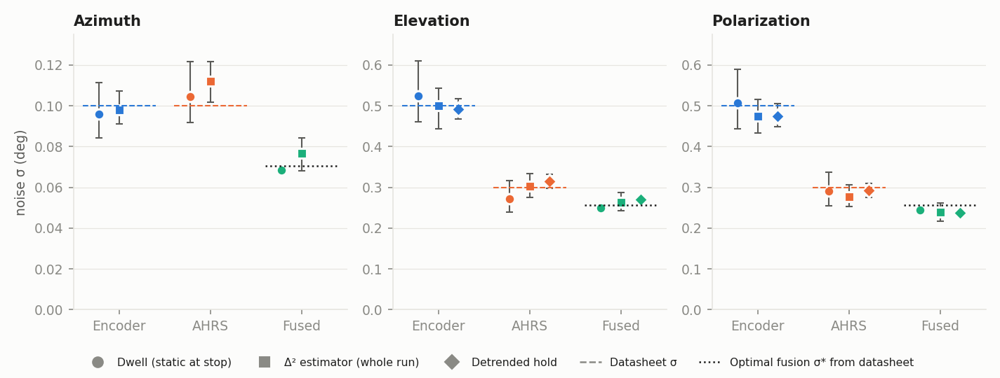
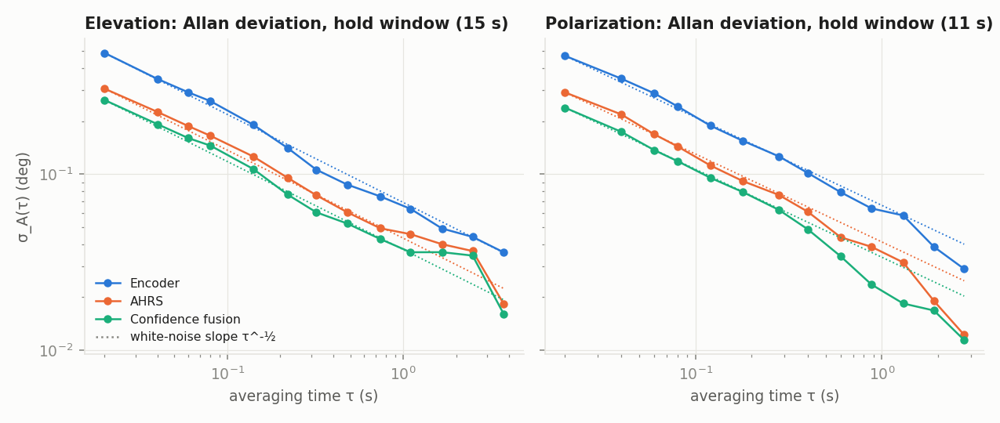
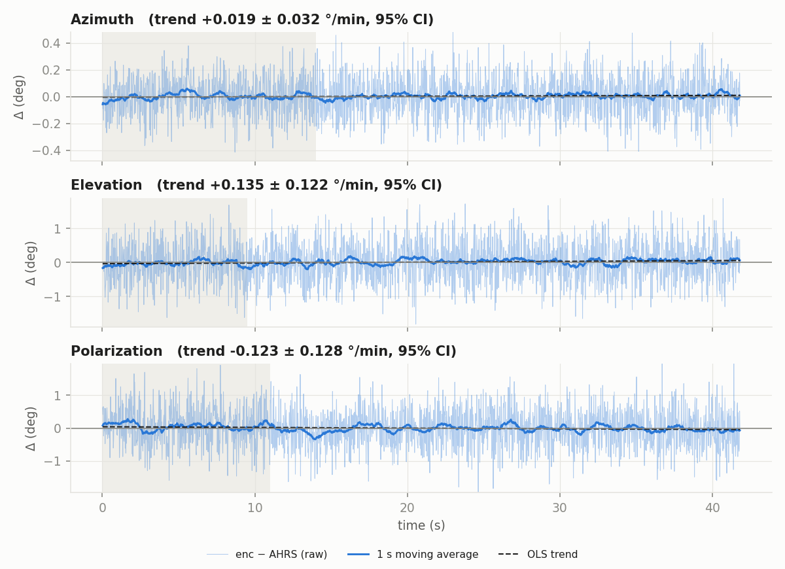
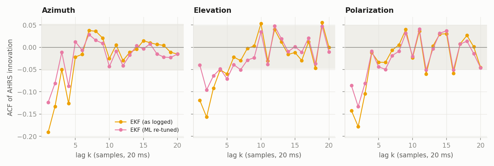
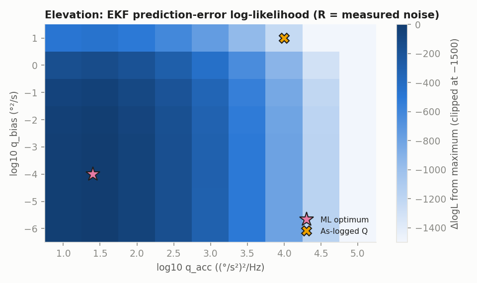
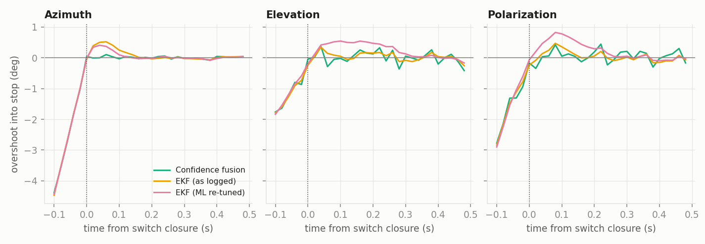
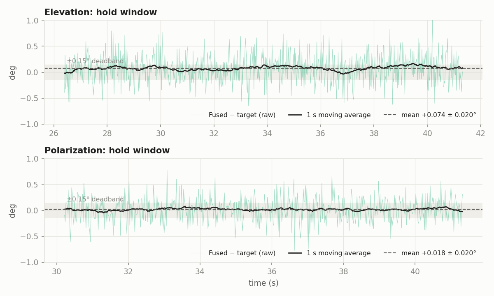

# Field-Test Analysis of Positioner Run `20261026_134545`

**Data:** `logs/sim_antenna_20261026_134545.csv`. 2 091 samples at fs = 50 Hz (Δt = 20 ms), t = 0.02–41.82 s.
**Unit under test:** 3-axis antenna positioner (azimuth, elevation, polarization). Each axis has an incremental encoder, an AHRS channel, an on-board confidence-weighted fusion, and an on-board EKF.
**Date:** 2026-10-26

> **How to read this document.** This is a worked example of how a log from the *real* device would be analyzed. The record is treated as if it came from hardware in the field. That means **there is no ground truth**. Every result below uses only the channels a real controller would log:
>
> - sensor readings: `*_enc`, `*_ahrs`, `*_fused`, `*_ekf`, `*_ekf_sigma`, `*_ekf_bias`, `*_c_enc`, `*_c_ahrs`
> - commands: `*_target`
> - limit switches and state flags: `*_lim_lo`, `*_lim_hi`, `*_calibrating`
>
> The simulator-only columns (`*_true`, `*_err_*`, `*_drift_*`, `*_glitch_offset`) are not used. The `*_sigma_enc` and `*_sigma_ahrs` values are used only as "datasheet" specifications, never as known truth. Because this record is really simulated, Appendix A checks the methods against the hidden truth. That check is not possible on hardware.
>
> The truth-based companion analysis of the same run is [SIM_ANALYSIS.md](SIM_ANALYSIS.md).

---

## Abstract

The positioner ran its startup limit-switch calibration on all three axes and then slewed to world targets: azimuth 90°, elevation 45°, polarization 45°. Without a reference instrument, performance was inferred from:

- the hard stops as known geometric references;
- the redundancy between encoder and AHRS;
- the statistical structure of the noise;
- the filter innovations.

Main findings:

1. **Data integrity is clean.**
   - The sampling is uniform: jitter ≈ 10⁻¹⁵ s, no gaps, no NaNs.
   - The two limit switches of an axis are never closed together.
   - The AHRS shows no motion while the axis dwells at a stop.
2. **Calibration.**
   - The estimated azimuth installation offset is **ô = +3.488° ± 0.011°** (1 SE). Elevation and polarization show offsets consistent with zero.
   - The measured spans match the nominal ranges to within 0.02° for azimuth and elevation.
   - The polarization LO and HI stops disagree by 0.16° (z = −2.8, Bonferroni p ≈ 0.014). This is flagged for a repeat calibration.
3. **Sensor noise.**
   - Three independent estimators agree, and they reproduce the datasheet values within their confidence intervals. The one exception is the azimuth AHRS, which is about 10 % noisier than its 0.10° specification.
   - The noise is white. Hold residuals have |r₁| ≤ 0.052, and the Allan deviation follows the τ−½ slope out to 3–4 s.
   - There is no measurable encoder–AHRS drift, latency, or scale-factor error.
4. **On-board fusion.**
   - The confidence fusion delivers the precision predicted from its weights: 0.077° / 0.264° / 0.240°.
   - That is 88–96 % of the optimal inverse-variance efficiency. The loss comes from its fixed sensor priors.
5. **On-board EKF.**
   - The EKF is **statistically inconsistent** with the data. Its normalized innovation squared (NIS) is 0.01–0.15 against an expected 2.
   - Its innovations are coloured (Ljung–Box p ≈ 0), and it reports σθ = 0.76° when the data support about 0.06–0.14°.
   - Maximum-likelihood re-tuning of R and Q raises the log-likelihood by more than 3 000 per axis and brings the NIS to 1.7–2.2. The remaining colour points to a model-structure limit (constant-velocity model vs. commanded rate steps).
6. **Pointing.**
   - Elevation and polarization settle inside the ±0.15° deadband.
   - Elevation shows a small but significant steady offset of **+0.074° ± 0.020°**.
   - The pointing jitter beyond sensor noise is below 0.10° (95 % upper bound).
   - Azimuth reached its target only at the very end of the record, so its hold performance cannot be assessed from this log.

---

## 1. Test setup

### 1.1 Configuration and specifications

| Axis | Nominal range | Datasheet σenc (°) | Datasheet σAHRS (°) | World target |
|---|---|---|---|---|
| Azimuth | 0 … 360 | 0.10 | 0.10 | 90 |
| Elevation | 0 … 90 | 0.50 | 0.30 | 45 |
| Polarization | 0 … 180 | 0.50 | 0.30 | 45 |

**Frame conventions.**

- All angle channels are logged in the **world frame**: the mechanical encoder angle plus the installation offset that the controller currently believes.
- The AHRS is assumed to be already corrected for declination and mounting, so it reads world angles directly:
  - azimuth is the heading;
  - elevation is the pitch;
  - polarization is the roll about the boresight.
- The AHRS is the **only absolute reference** on the unit. Every world-frame result in this report inherits its systematic accuracy. See §7.

**On-board estimators** (from the firmware documentation):

- **Confidence fusion.** Prior σ 1.5° (encoder) and 1.2° (AHRS). It uses a 50-sample agreement window, a drift penalty of 5·|mean(enc − AHRS)|, and quaternion SLERP blending with weight cenc.
- **EKF.** State [θ, ω, b]: angle, rate, and encoder bias. Constant-velocity model with white acceleration qacc = 10⁴ (°/s²)²/Hz and bias random walk qb = 10 °²/s. R = diag(1.5², 1.2²) and P₀ = diag(1.2², 50², 2²). Joseph-form update. It is initialized at the first AHRS sample.

### 1.2 Test sequence (reconstructed from the flags)

| Axis | LO switch closes | HI switch closes | Calibration ends | Samples post-calibration |
|---|---|---|---|---|
| Azimuth | 4.00 s | 13.00 s | 14.00 s | 1 392 |
| Elevation | 2.50 s | 8.50 s | 9.50 s | 1 617 |
| Polarization | 3.00 s | 10.00 s | 11.00 s | 1 542 |

Each axis drives to its LO stop and dwells for 50 samples (1 s) from switch closure. It then drives to the HI stop and dwells again. Finally it hands over to target tracking. The target channel is NaN until calibration ends.

*Figure 1. The on-board fused estimate: raw, and as a 1 s moving average. The dashed line is the commanded target. Shading marks calibration. Triangles mark limit-switch closures, plotted at the AHRS reading. The dotted line is where the stationarity detector (§2.7) declares the axis stopped.*

---

## 2. Methods

Notation: zE, zA and zF are the encoder, AHRS and fused readings of one axis at sample k. n is a sample count and neff an effective sample size. All confidence intervals are 95 % unless stated otherwise.

### 2.1 Data integrity

- **Sampling.** The Δt series is checked for jitter (std), gaps (Δt > 1.5·Δtnom) and NaNs.
- **Switches.** The test confirms that LO and HI are never asserted together, since that would indicate a wiring fault.
- **Motion during dwell.** In each dwell window the test fits an OLS slope to the AHRS, zAk = α + β tk. It requires β to be consistent with 0, so that the axis is actually resting on the stop.

### 2.2 Calibration from the hard stops

The hard stops are the only known geometry. Ideally they sit at the nominal limits Llo and Lhi in the mechanical frame, so in the world frame they sit at L + o, where o is the installation offset. The AHRS dwell mean at each stop gives an offset estimate:

$$
\hat o_{lo} = \bar z^{A}_{lo} - L_{lo},\qquad \hat o_{hi} = \bar z^{A}_{hi} - L_{hi},\qquad
\hat o = \tfrac12(\hat o_{lo} + \hat o_{hi})
$$

$$
\mathrm{SE}(\hat o) = \tfrac12\sqrt{\frac{s_{lo}^2}{n_{lo}} + \frac{s_{hi}^2}{n_{hi}}},\qquad n_{lo}=n_{hi}=50
$$

Here s is the sample std of the AHRS inside the dwell.

**Consistency test.** Both stops must imply the same offset. Otherwise the true span differs from nominal, or a stop is mis-set:

$$
z_{cons} = \frac{\hat o_{hi} - \hat o_{lo}}{\sqrt{s_{lo}^2/n_{lo} + s_{hi}^2/n_{hi}}}\ \sim\ \mathcal N(0,1)\ \text{under } H_0
$$

The test uses a two-sided p-value, Bonferroni-corrected over the three axes. The measured span is z̄Ahi − z̄Alo, compared with Lhi − Llo.

**Encoder–AHRS agreement at the stops.** The mean of zE − zA in each dwell, with CI ±1.96·s/√n, tests the relative bias without needing truth.

### 2.3 Sensor noise without a reference

Three estimators are used. They have different failure modes, so agreement between them is the evidence.

**(a) Dwell estimator.** While the axis rests on a stop, the true angle is constant. The sample std of the dwell residuals (each dwell de-meaned, pooled over both stops, ddof = 2) estimates σ directly. Its CI is the χ² interval

$$
\left[\, s\sqrt{\tfrac{n-1}{\chi^2_{0.975,\,n-1}}},\ \ s\sqrt{\tfrac{n-1}{\chi^2_{0.025,\,n-1}}}\,\right]
$$

**(b) Second-difference (Δ²) estimator over the whole post-calibration run.** For a signal that is smooth on the 20 ms scale plus white noise v,

$$
\Delta^2 z_k = z_{k+1} - 2z_k + z_{k-1} \approx v_{k+1} - 2v_k + v_{k-1},\qquad \operatorname{Var}(\Delta^2 z) = (1+4+1)\,\sigma^2 = 6\sigma^2
$$

The estimator uses the median absolute deviation (MAD), so that rare manoeuvre corners do not inflate it:

$$
\hat\sigma_{\Delta^2} = \frac{1.4826\cdot\operatorname{MAD}(\Delta^2 z)}{\sqrt 6}
$$

The CI comes from a moving-block bootstrap (blocks of 50 samples, B = 400). Only contiguous triples are kept inside each resample.

**(c) Detrended hold estimator.** In the stationary hold window (§2.7) a straight line is fitted and removed, and the residual std is taken (ddof = 2). The χ² CI uses the AR(1) effective sample size

$$
n_{eff} = n\,\frac{1-r_1}{1+r_1}
$$

where r₁ is the lag-1 autocorrelation of the residuals. r₁ is also reported as a whiteness check.

**Difference channel.** If the two sensors' noises are independent, the encoder−AHRS difference has

$$
\sigma_{E-A} = \sqrt{\sigma_E^2 + \sigma_A^2}
$$

Comparing σ̂Δ²(zE − zA) with √(σ̂E² + σ̂A²) tests that independence, which the fusion relies on.

**Allan deviation (hold window).** This is the overlapping Allan deviation of the angle record, treated as the rate-like series:

$$
\sigma_A^2(\tau) = \tfrac12\,\big\langle(\bar z_{j+m} - \bar z_j)^2\big\rangle,\qquad \tau = m\,\Delta t
$$

Here z̄j is the mean over m consecutive samples. White noise gives σA(τ) = σ·√(Δt/τ), a slope of −½ on log–log axes. A flattening or upturn would reveal bias instability or random walk.

### 2.4 Relative drift, latency and scale

**Drift.** An OLS line is fitted to dk = zEk − zAk over the whole run. The standard error of the slope is inflated by √(n/neff) to account for residual autocorrelation. The trend is reported in °/min.

**Latency.** During motion (|dz̄/dt| > 2 °/s), the 15-sample smoothed rates of the two sensors are cross-correlated. The peak is located with a parabolic fit:

$$
\hat\ell = \ell^* + \tfrac12\,\frac{c_{\ell^*-1} - c_{\ell^*+1}}{c_{\ell^*-1} - 2c_{\ell^*} + c_{\ell^*+1}}
$$

The CI comes from a bootstrap over 50-sample blocks. Cross-products are summed per block, so that no correlation is formed across block joins.

**Scale factor.** Both sensors are noisy, so ordinary least squares of zE on zA is biased toward zero (regression dilution). The test instead uses **Deming regression** with λ = σ̂E²/σ̂A²:

$$
\hat\beta = \frac{s_{yy} - \lambda s_{xx} + \sqrt{(s_{yy}-\lambda s_{xx})^2 + 4\lambda s_{xy}^2}}{2 s_{xy}}
$$

with x = zA and y = zE. It is reported as (β̂ − 1)·10⁶ ppm, with a block-bootstrap CI.

### 2.5 Fusion efficiency

The fusion output is zF ≈ c·zE + (1−c)·zA, with independent noises. Its predicted noise, from the logged mean weight c̄ and the *measured* sensor noise, is

$$
\hat\sigma_F = \sqrt{\bar c^{\,2}\hat\sigma_E^2 + (1-\bar c)^2\hat\sigma_A^2}
$$

The inverse-variance optimum is

$$
c^* = \frac{\hat\sigma_A^2}{\hat\sigma_E^2+\hat\sigma_A^2},\qquad
\sigma^* = \left(\hat\sigma_E^{-2}+\hat\sigma_A^{-2}\right)^{-1/2},\qquad
\eta = \left(\frac{\sigma^*}{\hat\sigma_F}\right)^2
$$

η is the statistical efficiency. Predicted σ̂F is compared with the Δ² estimate of the logged fused channel.

### 2.6 EKF consistency and re-tuning

**Replay.** The documented EKF is re-implemented and run offline on the logged zE and zA. The replay matches the logged `*_ekf` to within 0.006–0.015°. The small residual is the frame re-reference at calibration hand-over. The replay matches the logged σθ to within 5×10⁻⁷. This confirms that the firmware matches its documentation and gives access to the innovations, which are not logged.

**Innovation tests.** For the innovation νk = zk − H x̂k|k−1, with covariance Sk:

- The NIS is εk = νkᵀ Sk⁻¹ νk ∼ χ²₂ for a consistent filter. Its time average over n samples must lie in

$$
\left[\tfrac{1}{n}\chi^2_{0.025,\,2n},\ \tfrac{1}{n}\chi^2_{0.975,\,2n}\right] \approx [1.90,\ 2.10]
$$

- Whiteness is tested with Ljung–Box over h = 20 lags:

$$
Q = n(n+2)\sum_{j=1}^{h}\frac{\hat r_j^2}{n-j}\ \sim\ \chi^2_h
$$

**Maximum-likelihood tuning.** R is fixed at the measured noise, R = diag(σ̂E², σ̂A²). The process noise is then chosen to maximize the prediction-error log-likelihood:

$$
\log L(q_{acc}, q_b) = -\tfrac12\sum_{k\ge 5}\Big(\log\det S_k + \nu_k^\top S_k^{-1}\nu_k + 2\log 2\pi\Big)
$$

The search uses a 9 × 8 log-grid over qacc ∈ [10, 10⁵] and qb ∈ [10⁻⁶, 10], followed by a finer 1-D grid in qacc. The first five samples are burn-in.

### 2.7 Transient and positioning metrics (measured data)

**Stop-arrival transient.** The hard stop is a step change in rate at a known, constant position. The reference is the AHRS mean over dwell samples 15–49, after any transient. For each estimator x the signed deviation (xk − ref)·dir is taken, with dir = −1 at LO and +1 at HI, so that a positive value means "past the stop". These profiles are averaged over the two stops.

**Positioning.** These metrics use the 1 s centred moving average z̄F of the fused estimate. It has a noise of σF/√50 ≈ 0.04° or less.

- **Rise time:** the time from 10 % to 90 % of the commanded move.
- **Overshoot:** max(0, max frac − 1) in % and in degrees.
- **Band entry:** the first time |z̄F − target| ≤ 0.15°.
- **Settling:** the last exit from that band.
- **Stationarity:** the time after which the 1 s-baseline rate of z̄F stays below 0.15 °/s. This defines the **hold window**.

**Hold accuracy.** The test reports the mean of ek = zFk − target over the hold, with CI ±1.96·s/√neff.

**Pointing jitter** beyond sensor noise is estimated by variance subtraction:

$$
\hat\sigma_{jit}^2 = s_{hold}^2 - \hat\sigma_F^2
$$

Its one-sided 95 % upper bound uses the χ² upper bound on shold.

---

## 3. Results: data integrity and calibration

### 3.1 Integrity

| Check | Result |
|---|---|
| Δt mean / std / gaps | 0.0200 s / ~10⁻¹⁵ s / 0 |
| NaNs in sensor channels | 0 |
| LO and HI simultaneously closed | never (all axes) |
| AHRS slope during dwell | consistent with 0 at every stop (95 % CI contains 0) |

### 3.2 Hard-stop calibration

| Axis | ôlo (°) | ôhi (°) | **ô ± SE (°)** | zcons (p) | Measured span (°) | Span − nominal (°) |
|---|---|---|---|---|---|---|
| Azimuth | +3.4776 | +3.4974 | **+3.4875 ± 0.0105** | +0.95 (0.34) | 360.020 | +0.020 |
| Elevation | +0.0183 | +0.0450 | **+0.0317 ± 0.0272** | +0.49 (0.62) | 90.027 | +0.027 |
| Polarization | +0.1029 | −0.0610 | **+0.0209 ± 0.0291** | **−2.82 (0.005)** | 179.836 | **−0.164** |

| Axis | enc − AHRS at LO stop (°) | enc − AHRS at HI stop (°) |
|---|---|---|
| Azimuth | +0.019 ± 0.038 | +0.025 ± 0.044 |
| Elevation | −0.055 ± 0.16 | −0.082 ± 0.18 |
| Polarization | −0.101 ± 0.15 | +0.099 ± 0.20 |

**Interpretation.**

- **Azimuth.** The installation offset of +3.49° is resolved to ±0.02° (95 %). The two stops agree, and the span is 360° within 0.02°.
- **Elevation.** The mount is level to within the resolution: the offset is consistent with 0 at about 1.2 SE.
- **Polarization.** The LO and HI stops imply offsets 0.16° apart. After a Bonferroni correction over three axes, p ≈ 0.014. In the field this could be:
  1. a stop that is mis-set or compliant, so the span really is 179.84°;
  2. a polarization-dependent AHRS roll error, for example a cross-axis misalignment;
  3. a 1-in-70 noise excursion of a single 50-sample mean.

  A single run cannot separate these. Action: **repeat the calibration** (§8). The encoder–AHRS difference at the polarization stops changes sign between LO and HI (−0.10, +0.10). That is mildly suggestive of a span or scale effect in one sensor, but it is not significant on its own.

---

## 4. Results: sensor characterization

### 4.1 Noise

| Axis | Sensor | Datasheet | Dwell [95 % CI] | Δ² [95 % CI] | Hold [95 % CI] | Hold r₁ |
|---|---|---|---|---|---|---|
| Azimuth | Encoder | 0.10 | 0.0959 [0.084, 0.112] | 0.0979 [0.091, 0.107] | n/a | n/a |
| Azimuth | AHRS | 0.10 | 0.1045 [0.092, 0.122] | **0.1120 [0.102, 0.122]** | n/a | n/a |
| Azimuth | Fused | n/a | 0.0683 [0.060, 0.079] | 0.0766 [0.068, 0.084] | n/a | n/a |
| Elevation | Encoder | 0.50 | 0.5249 [0.461, 0.610] | 0.5006 [0.445, 0.543] | 0.4910 [0.467, 0.517] | +0.009 |
| Elevation | AHRS | 0.30 | 0.2722 [0.239, 0.316] | 0.3027 [0.276, 0.334] | 0.3144 [0.299, 0.332] | +0.052 |
| Elevation | Fused | n/a | 0.2494 [0.219, 0.290] | 0.2635 [0.243, 0.287] | 0.2701 | +0.044 |
| Polarization | Encoder | 0.50 | 0.5065 [0.444, 0.589] | 0.4742 [0.433, 0.517] | 0.4750 [0.448, 0.505] | +0.020 |
| Polarization | AHRS | 0.30 | 0.2908 [0.255, 0.338] | 0.2765 [0.254, 0.307] | 0.2923 [0.276, 0.311] | +0.003 |
| Polarization | Fused | n/a | 0.2439 [0.214, 0.284] | 0.2398 [0.217, 0.262] | 0.2375 | −0.010 |

The azimuth axis never became stationary before the end of the record (§6), so it has no hold window.

*Figure 2. Noise σ from three independent estimators (marker shape) with 95 % CIs. Dashed lines are the datasheet values. The dotted line is the optimal fusion σ\* implied by the datasheet.*

- The three estimators agree to within their CIs for every sensor. The dwell estimator (only 100 samples) has the widest intervals, and the hold estimator the narrowest.
- Every datasheet value lies inside at least one 95 % CI except the **azimuth AHRS**. Its Δ² estimate, 0.112 [0.102, 0.122], sits just above the 0.10° specification; the dwell estimate, 0.105, is consistent with it. **Treat σA,az ≈ 0.11° as the working value** until more data are available.
- Hold residuals are white (|r₁| ≤ 0.052). There is therefore no slow wander at the 20 ms–1 s scale.

**Independence check (difference channel).**

| Axis | σ̂Δ²(enc − AHRS) | √(σ̂E² + σ̂A²) |
|---|---|---|
| Azimuth | 0.1458 | 0.1488 |
| Elevation | 0.5725 | 0.5850 |
| Polarization | 0.5559 | 0.5490 |

These agree within about 2 %, so the encoder and AHRS noises are uncorrelated, as the fusion assumes.

### 4.2 Allan deviation

*Figure 3. Overlapping Allan deviation over the hold windows. Dotted lines are the white-noise τ−½ extrapolation from the shortest τ.*

| Axis | τmax | Encoder (white prediction) | AHRS (white prediction) | Fused (white prediction) |
|---|---|---|---|---|
| Elevation | 3.72 s | 0.0360 (0.0358) | 0.0184 (0.0224) | 0.0161 (0.0193) |
| Polarization | 2.76 s | 0.0289 (0.040) | 0.0122 (0.0248) | 0.0114 (n/a) |

- All curves follow the −½ slope, and none has a floor or upturn up to τ ≈ 3–4 s.
- Values below the white-noise line at the largest τ come from the few independent averages available there: only about 4 segments, so the estimate is very uncertain.
- **Conclusion:** no bias instability is detectable on this time scale. A characterization out to τ ≥ 100 s needs a dedicated static record (§8).

### 4.3 Relative drift, latency and scale

| Axis | Mean enc − AHRS (°) | Trend (°/min) | Latency enc → AHRS (ms) | Scale, Deming (ppm) | OLS (ppm) | Range used (°) |
|---|---|---|---|---|---|---|
| Azimuth | +0.0026 ± 0.0064 | +0.019 ± 0.032 | +0.01 [−0.03, +0.05] | −59 [−114, +16] | n/a | 274.7 |
| Elevation | +0.0076 ± 0.0245 | +0.135 ± 0.122 | +0.21 [−0.35, +0.80] | −1850 [−3487, +540] | −2315 | 47.4 |
| Polarization | −0.0011 ± 0.026 | −0.123 ± 0.128 | +0.11 [−0.17, +0.47] | −503 [−1478, +411] | n/a | 136.8 |

*Figure 4. Encoder − AHRS difference, raw and as a 1 s moving average, with its OLS trend.*

- **Drift.** No axis shows significant relative drift. Elevation, +0.135 ± 0.122 °/min, is borderline: the interval barely excludes 0 at 95 %. It is not significant after correcting for three axes, but it is worth watching on a longer run.
- **Latency.** The latency is below 1 ms on all axes and consistent with zero. The two sensors are time-aligned to well within one sample.
- **Scale.** No significant scale error. OLS is visibly attenuated relative to Deming on elevation (−2315 vs −1850 ppm), as expected from regression dilution. The elevation interval is wide because its range is only 47°.
- **Calibration consistency.** After hand-over, the mean enc − AHRS is consistent with 0 on all axes. The encoder world frame, which the calibration created, is therefore aligned with the AHRS world frame to better than ±0.03°.

---

## 5. Results: on-board estimators

### 5.1 Confidence fusion

| Axis | Mean cenc | c\* (measured noise) | σ̂F predicted | σ̂F measured (Δ²) | σ\* | η |
|---|---|---|---|---|---|---|
| Azimuth | 0.384 | 0.567 | 0.0786 | 0.0766 | 0.0737 | 0.88 |
| Elevation | 0.354 | 0.268 | 0.2639 | 0.2635 | 0.2590 | 0.96 |
| Polarization | 0.348 | 0.254 | 0.2445 | 0.2398 | 0.2389 | 0.96 |

- The measured fused noise matches the prediction from the logged weights to within 3 %. The fusion therefore behaves as a linear combiner of independent sensors.
- The weights hover around 0.35–0.38 regardless of axis. That is close to the prior-only value 1.2²/(1.5² + 1.2²) = 0.39, so the **fixed priors dominate the weights**.
- On azimuth, where the encoder is the better sensor, this costs 12 % efficiency (c̄ = 0.38 vs c\* = 0.57).
- Setting the priors from the measured noise would recover most of that loss.

### 5.2 EKF as deployed

| Axis | NIS mean (expected 2, 95 % ≈ [1.90, 2.10]) | AHRS innovation r₁ | Ljung–Box p (AHRS / enc) | Reported σθ |
|---|---|---|---|---|
| Azimuth | **0.010** | −0.19 | ≈ 0 / ≈ 0 | 0.7635 |
| Elevation | **0.144** | −0.12 | ≈ 0 / ≈ 0 | 0.7635 |
| Polarization | **0.146** | −0.14 | ≈ 0 / ≈ 0 | 0.7635 |

The EKF fails both consistency tests:

- **NIS ≪ 2.** The innovation covariance S is 14–200 times too large. The cause is R = diag(1.5², 1.2²), which overstates the true sensor variances by 9–225×, combined with a very large qacc.
- **Identical σθ on all axes.** The reported σθ is the same 0.7635° on every axis because P does not depend on the data. It is therefore *not* information about pointing accuracy.
- **Negative lag-1 innovation autocorrelation.** This is the classic signature of a filter that over-reacts: a gain that is too high for the actual noise.

### 5.3 Maximum-likelihood re-tuning

| Axis | q̂acc | q̂b | log L: ML / as-logged Q / fully as-logged | NIS | AHRS innovation r₁ | Ljung–Box p (AHRS / enc) | σθ |
|---|---|---|---|---|---|---|---|
| Azimuth | 125.9 | 10⁻⁶ | **2599.6** / −554.1 / −6145.7 | 1.69 | −0.12 | 1.7·10⁻⁴ / ≈ 0 | 0.057 |
| Elevation | 25.1 | 10⁻⁴ | **−2310.7** / −3550.3 / −6283.2 | 1.91 | −0.04 | 5·10⁻⁶ / 0.58 | 0.138 |
| Polarization | 63.1 | 10⁻³ | **−2417.9** / −3529.5 / −6284.6 | 2.17 | −0.09 | 10⁻⁸ / 0.054 | 0.142 |

*Figure 5. Autocorrelation of the AHRS innovation, for the EKF as logged and after ML re-tuning. The shaded band is the ±1.96/√n white-noise band.*

*Figure 6. Elevation: log-likelihood over the (qacc, qb) grid, relative to its maximum. The as-logged process noise sits far down the surface.*

- The log-likelihood improves by more than 3 800 nats on every axis. Most of the gain comes from correcting R; the rest comes from lowering qacc by about two orders of magnitude.
- **Encoder-bias process noise.** The ML qb is at or near the lower grid edge. The data show no evidence of an encoder bias that changes over time, which agrees with §4.3.
- **Consistency.** NIS moves into or close to the consistent band. The reported σθ drops to 0.06° / 0.14° / 0.14°, about 0.5–0.75 of the fused noise, as expected from additional temporal smoothing.
- **Remaining colour.** The AHRS innovations are still coloured (Ljung–Box p < 10⁻³). A constant-velocity model treats the commanded rate steps (start, stop, hard-stop arrival) as white acceleration, which they are not. This is a **model-structure** limit that tuning cannot remove (§8).

### 5.4 Response at the hard stops

*Figure 7. Signed deviation from the hard-stop reference, averaged over the two stops. Positive means "past the stop", which is physically impossible, so any positive excursion is estimator error.*

| Axis | Fused: peak (mean 0–0.2 s) | EKF as logged | EKF re-tuned |
|---|---|---|---|
| Azimuth | +0.105 (+0.020) | +0.522 (+0.233) | +0.409 (+0.145) |
| Elevation | +0.368 (+0.036) | +0.347 (+0.068) | +0.546 (+0.392) |
| Polarization | +0.423 (+0.011) | +0.473 (+0.125) | +0.826 (+0.488) |

The axis cannot physically pass the stop. A sustained positive deviation after closure is therefore unambiguous estimator lag: the filter is still extrapolating the pre-impact rate.

- The **fused** estimate has no memory. Its peaks are single-sample noise (0.1–0.4°), and its 0–0.2 s mean is ≈ 0.
- **Both EKFs overshoot systematically** by 0.2–0.8° for 0.1–0.3 s.
- The **re-tuned** EKF, being smoother, lags *more* on elevation and polarization.

This is the trade-off: lower qacc buys steady-state precision at the cost of manoeuvre response. Only a model that knows about the commanded rate can resolve it.

---

## 6. Results: pointing performance

| Axis | Move (°) | Rise 10–90 % | Band entry | Settle (last exit) | Stationary from | Overshoot | Peak rate |
|---|---|---|---|---|---|---|---|
| Azimuth | 363.36 → 90 | 15.96 s | 24.54 s | 27.22 s | 27.82 s (end of record) | 0.28 % (0.78°) | 15.33 °/s |
| Elevation | 89.97 → 45 | 6.10 s | 9.46 s | 30.30 s\* | 16.90 s | 2.49 % (1.12°) | 7.58 °/s |
| Polarization | 179.88 → 45 | 9.88 s | 15.46 s | 18.18 s | 19.22 s | 0.62 % (0.84°) | 14.31 °/s |

Times are measured from the end of each axis's calibration.

\*The late "last exit" on elevation does not mean the axis was still moving. The smoothed estimate sits at +0.074°, so noise of about ±0.04° occasionally takes it past the 0.15° band edge. The stationarity criterion (16.9 s) is the meaningful settling time here.

**Hold accuracy.**

| Axis | n (hold) | Mean error (°) | shold | σ̂F predicted | σ̂jit² | Jitter 95 % upper bound | Encoder-only / AHRS-only mean |
|---|---|---|---|---|---|---|---|
| Elevation | 747 | **+0.074 ± 0.020** | 0.2701 | 0.2639 | +0.0033 | 0.10° | +0.092 / +0.065 |
| Polarization | 556 | +0.018 ± 0.020 | 0.2374 | 0.2445 | −0.0034 | 0.051° | n/a |

*Figure 8. Fused estimate minus target over the hold window, raw and as a 1 s moving average. The shaded band is the ±0.15° controller deadband.*

- **Elevation** holds with a **statistically significant offset of +0.074°**. It is inside the 0.15° deadband, so it is expected behaviour of a deadband controller: the axis stops as soon as it enters the band. Both sensors independently see it (+0.092° and +0.065°), so it is a real pointing offset and not a fusion artefact.
- **Polarization** holds on target: the offset is not significant.
- **Jitter** beyond sensor noise is undetectable on both axes. The hold variance equals the fused-noise variance within its uncertainty, so mechanical pointing jitter is below 0.10° (elevation) and below 0.05° (polarization) at 95 %.
- **Azimuth** became stationary only at the end of the record. The log is too short to assess its hold performance. The slew from the HI stop (363.4°) to 90° travels the long way round, 273° in about 27 s, because the cable-wrap range has no wrap-around. That is correct behaviour for a bounded axis, but it is the dominant term in azimuth acquisition time.

---

## 7. Discussion and limitations

1. **The absolute reference is the AHRS itself.** Every world-frame number (installation offset, pointing error, hold offset) is relative to the AHRS. Its *random* error is fully characterized above. Its *systematic* error is not observable from this log: magnetic disturbance near the mount, residual declination, and mounting misalignment. An AHRS heading bias of 0.5° would shift every azimuth result by 0.5° without changing any statistic in this report.
2. **One calibration, 50 samples per stop.** The calibration SE is the precision of a *single* run. Repeatability (stop compliance, switch hysteresis, thermal effects) needs several runs. The polarization LO/HI disagreement is the clearest example: one run cannot tell a 1-in-70 noise excursion from a 0.16° span error.
3. **Short record.** About 42 s allows Allan deviation only to τ ≈ 4 s and gives no azimuth hold window. Slow effects (thermal drift, bias instability) are therefore unconstrained.
4. **Gaussian white-noise assumption.** All CIs assume approximately Gaussian, approximately white noise. The data support this (|r₁| ≤ 0.052, Allan slope −½), but heavy tails were not tested on hardware-length records.
5. **Single operating point.** One target per axis. Pointing errors that depend on angle (for example gravity sag in elevation or a cable-wrap torque) cannot be separated from a constant offset.
6. **Innovations are reconstructed, not logged.** The EKF innovation analysis depends on the offline replay. The replay matches the logged output to 0.015°, but the firmware should log ν and S directly.

---

## 8. Recommendations

| # | Action | Addresses |
|---|---|---|
| 1 | **Repeat the startup calibration 5–10 times** (power-cycle between runs). Report the mean and std of ô and span per axis, and settle the polarization LO/HI question. | §3.2, §7.2 |
| 2 | **Verify north independently** with a sun sighting, a GNSS dual-antenna baseline, or a surveyed landmark. Compare with ôaz to bound the AHRS heading bias. | §7.1 |
| 3 | **Record a static 30–60 min log** at a fixed pose for Allan deviation out to τ ≥ 100 s. This characterizes bias instability and thermal drift. | §4.2, §7.3 |
| 4 | **Re-tune the EKF:** R = diag(σ̂E², σ̂A²) from §4.1; qacc ≈ 25–130 and qb ≈ 10⁻⁴ from §5.3. Then validate NIS on a new run. | §5.2–5.3 |
| 5 | **Give the EKF the commanded rate as a control input**, or use an IMM with stationary and slewing modes, to remove the innovation colour and the stop-arrival lag. | §5.3–5.4 |
| 6 | **Set the fusion priors from the measured noise** (e.g. 0.10/0.11° azimuth, 0.50/0.30° elevation and polarization). This recovers up to 12 % efficiency on azimuth. | §5.1 |
| 7 | **Investigate the elevation hold offset:** tighten the deadband, add an integral term near target, or check the angle dependence with a multi-target test. | §6 |
| 8 | **Extend the log** until every axis has ≥ 20 s of hold, and **log EKF innovations and S** directly. | §6, §7.6 |
| 9 | **Re-check the azimuth AHRS noise** (0.112° vs 0.10° specification) on the static run of item 3. Update the datasheet value if confirmed. | §4.1 |

---

## Appendix A. Method validation (possible only because this record is simulated)

This check **cannot be done on hardware**. It uses the simulator's hidden truth (`*_true`, `*_err_*`) only to grade the truth-free methods above.

| Quantity | Axis | Field estimate (no truth) | Truth | Verdict |
|---|---|---|---|---|
| Calibration offset ô | Azimuth | +3.4875 ± 0.0105 | error −0.0106 | within 1.0 SE ✓ |
| Calibration offset ô | Elevation | +0.0317 ± 0.0272 | error +0.0317 | within 1.2 SE ✓ |
| Calibration offset ô | Polarization | +0.0209 ± 0.0291 | error +0.0209 | within 0.7 SE ✓ |
| σAHRS | Azimuth | 0.112 | 0.103 | slightly high, CI touches truth |
| σenc | Polarization | 0.474 | 0.499 | slightly low, within CI |
| Fused σ | Azimuth / Elevation / Polarization | 0.0786 / 0.2639 / 0.2445 (predicted) | 0.0731 / 0.2652 / 0.2595 | within 1–8 % ✓ |
| Elevation hold offset | Elevation | +0.074 ± 0.020 | +0.0851 | ✓ |
| Polarization hold offset | Polarization | +0.018 ± 0.020 | +0.0097 | ✓ |
| Hold-window jitter | Elevation / Polarization | ≤ 0.10 / ≤ 0.05 (95 % UB) | true std 0.0000 / 0.0000 | ✓ (axes truly stationary) |

**The polarization LO/HI flag (§3.2) was a noise fluke.** The true angle is constant across both dwells. The AHRS mean in the LO dwell happened to be 2.6 SE off. The consistency test did its job: it correctly reported an unlikely event, and the recommended action (repeat the calibration) is the right response in the field.

**Effect of the ML re-tuning on true error** (post-calibration):

| Axis | RMSE: EKF as logged → re-tuned (°) | Max \|e\|: as logged → re-tuned (°) | NEES of re-tuned σθ (ideal 1) |
|---|---|---|---|
| Azimuth | 0.0555 → **0.0511** | 0.180 → 0.183 | 0.79 |
| Elevation | 0.1854 → **0.1225** | 0.632 → 0.401 | 0.79 |
| Polarization | 0.1756 → **0.1317** | 0.590 → 0.449 | 0.86 |

The re-tuning, chosen *without* truth, cuts the true RMSE by 8–34 % and the worst-case error by up to 37 %. Its reported σθ is now within about 10–15 % of the true error (NEES 0.8–0.9), compared with 4–14× too pessimistic before. This confirms that innovation-based maximum likelihood is a sound field-tuning procedure.

---

## Appendix B. Reproducibility

- **Input:** `logs/sim_antenna_20261026_134545.csv`. Columns used: `time_s`, `{ax}_enc`, `{ax}_ahrs`, `{ax}_fused`, `{ax}_ekf`, `{ax}_ekf_sigma`, `{ax}_c_enc`, `{ax}_target`, `{ax}_lim_lo`, `{ax}_lim_hi`, `{ax}_calibrating`; datasheet σ from `{ax}_sigma_enc` and `{ax}_sigma_ahrs`.
- **Fixed parameters:** dwell = 50 samples from switch closure; hard-stop reference = dwell samples 15–49; smoothing = 50-sample centred moving average; stationarity threshold = 0.15 °/s over a 1 s baseline; deadband = ±0.15°; motion threshold for latency = 2 °/s; block bootstrap = 50-sample blocks, B = 400 (noise, scale) or 1 000 (latency), seeds 1 and 2.
- **EKF re-implementation:** F = [[1, Δt, 0], [0, 1, 0], [0, 0, 1]]; H = [[1, 0, 1], [1, 0, 0]] (encoder sees θ + b, AHRS sees θ); Q from continuous white acceleration, qacc·[[Δt³/3, Δt²/2], [Δt²/2, Δt]], plus qbΔt on the bias; Joseph-form covariance update.
- **Software:** Python 3, NumPy, pandas, SciPy, Matplotlib. Figures are in `docs/images/analysis_134545/`.
