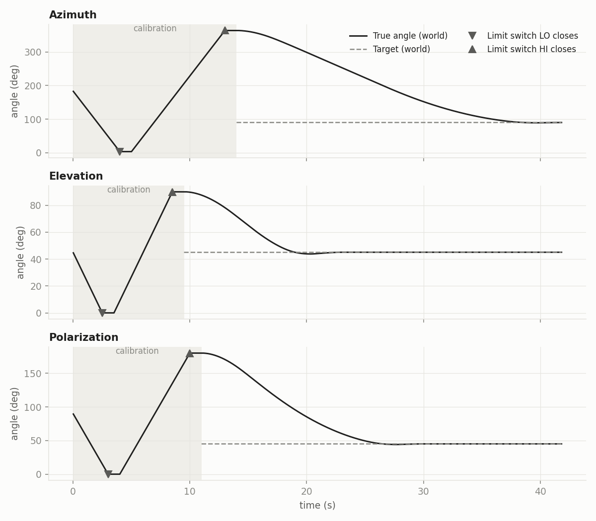
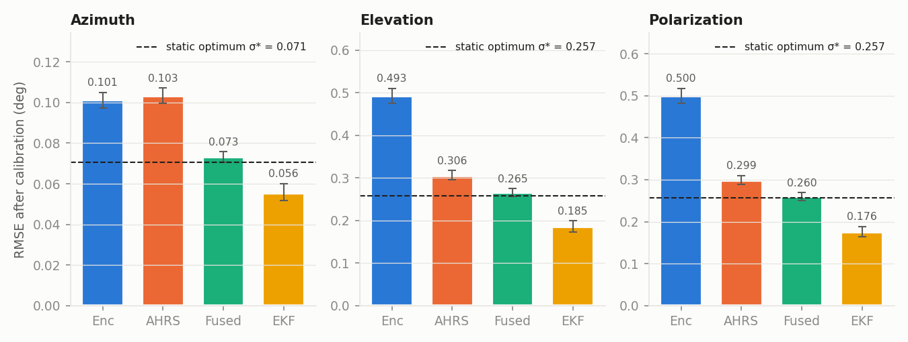
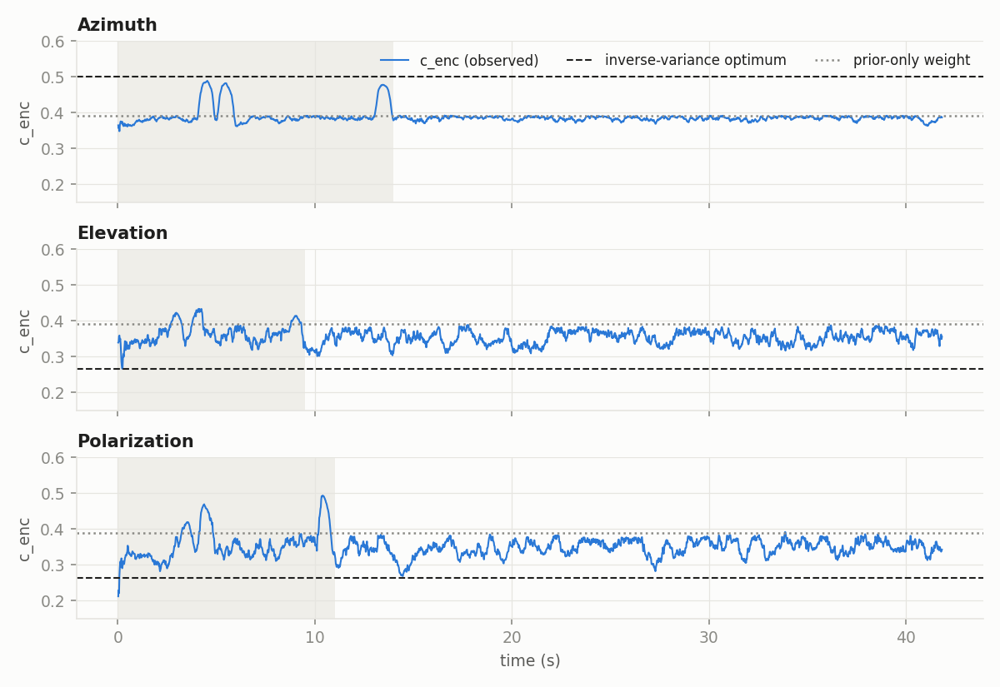
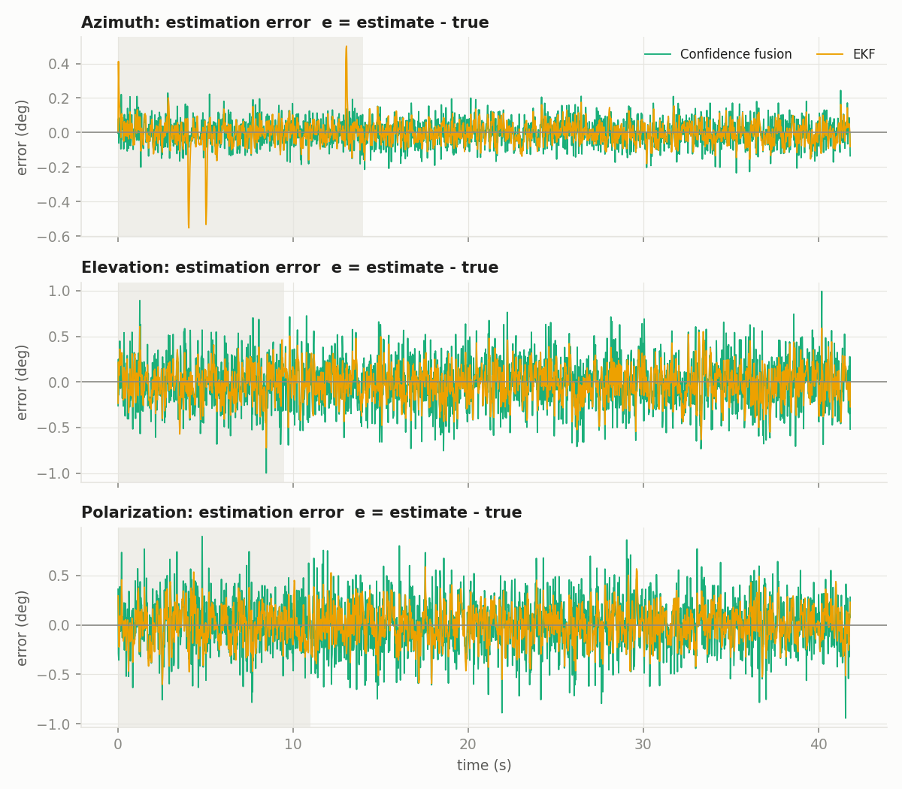
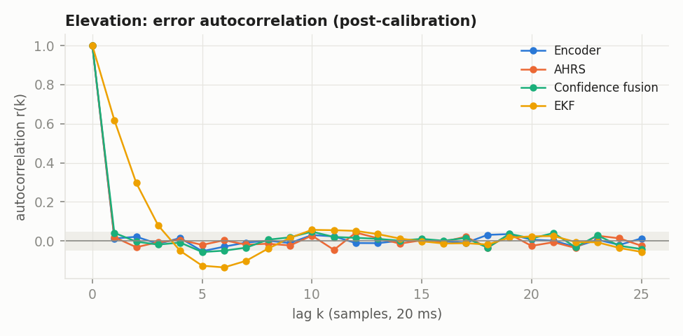
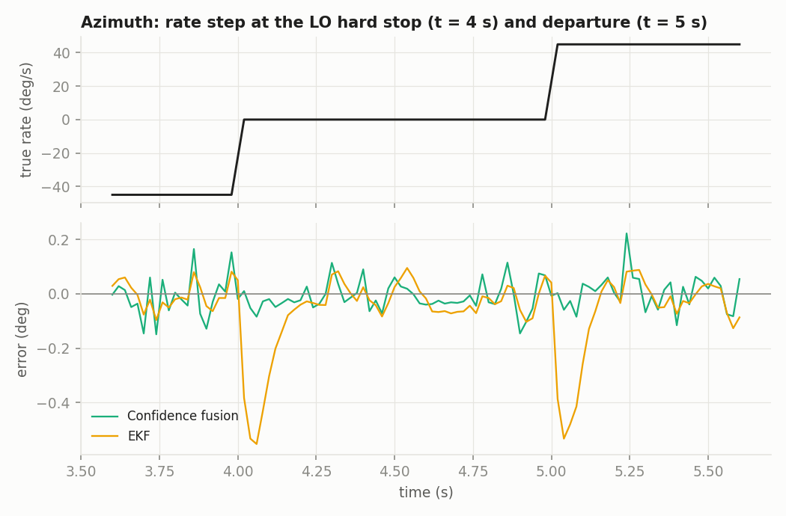

# Analysis of Simulation Run `sim_antenna_20261026_134545`

**Data:** `logs/sim_antenna_20261026_134545.csv`. 2 091 samples, 78 channels, sampled at fs = 50 Hz (Δt = 20 ms), t = 0.02–41.82 s.
**System:** 3-axis antenna positioner (azimuth, elevation, polarization). Each axis has an encoder, an AHRS, a confidence-weighted quaternion fusion, and an EKF baseline.
**Date:** 2026-10-26

---

## Abstract

This run records the startup limit-switch calibration of all three axes, followed by a commanded slew to world targets: azimuth 90°, elevation 45°, polarization 45°. No faults (drift, glitch) were injected, so every sensor error is zero-mean white Gaussian noise. The simulator also logs ground truth, so each estimator's error can be measured exactly.

Main results:

1. **Calibration.**
   - It recovered the installation offset of the azimuth seam (true +3.498°). The errors were −0.013° (azimuth), +0.032° (elevation) and +0.018° (polarization).
   - All three are within 1.3 standard errors of the theoretical precision σAHRS/√100.
2. **Confidence fusion vs the sensors.**
   - It reduces RMSE against the better single sensor by 28 % (azimuth) and 13 % (elevation, polarization). The improvement is significant (Diebold–Mariano, p < 10⁻¹⁵).
   - It reaches 94–98 % of the statistical efficiency of the optimal static (inverse-variance) combiner. The remaining gap comes from the fixed sensor priors, which dominate the confidence weights.
3. **EKF vs confidence fusion.**
   - After calibration the EKF has a lower RMSE than the fusion: 0.056° / 0.185° / 0.176° against 0.073° / 0.265° / 0.260°.
   - It achieves this through temporal smoothing. As a result, its errors are strongly autocorrelated (r₁ ≈ 0.6). It shows a transient error of up to 0.55° (≈ 5.5σ) after abrupt rate changes, and its reported uncertainty is 4–14× too pessimistic.
4. **Positioning.** All axes settled inside the ±0.15° hold band, with overshoot of 0.3–2.7 % and final steady-state error ≤ 0.085°.

---

## 1. Experimental setup

### 1.1 Run configuration (read from the log)

| Axis | Range (mech.) | σenc (°) | σAHRS (°) | Calibration slew vcal (°/s) | Start pose (mech.) | World target |
|---|---|---|---|---|---|---|
| Azimuth | 0 … 360 | 0.10 | 0.10 | 45 | 180 | 90 |
| Elevation | 0 … 90 | 0.50 | 0.30 | 18 | 45 | 45 |
| Polarization | 0 … 180 | 0.50 | 0.30 | 30 | 90 | 45 |

The fault channels (`*_drift_rate`, `*_drift_offset`, `*_glitch_offset`) are zero for the whole run.

### 1.2 Measurement model

For each axis, with true angle θk at sample k, the sensors are modeled as:

$$
z^{E}_k = \theta_k + b_k + v^{E}_k,\qquad z^{A}_k = \theta_k + v^{A}_k,\qquad
v^{E}_k\sim\mathcal N(0,\sigma_E^2),\; v^{A}_k\sim\mathcal N(0,\sigma_A^2)
$$

Here bk is the encoder fault offset (drift plus glitch), which is 0 in this run.

The logged error of an estimator x̂ is

$$
e_k = \hat\theta_k - \theta_k \quad(\text{deg})
$$

This is computed in the mechanical frame, so it does not depend on the world-frame calibration.

### 1.3 Analysis windows

| Window | Definition | n (az / el / pol) |
|---|---|---|
| Calibration | `{axis}_calibrating = 1` | 699 / 474 / 549 |
| **Post-calibration** (primary) | `{axis}_calibrating = 0` | 1392 / 1617 / 1542 |
| Moving / static | \|dθ/dt\| > 0.5 °/s or ≤ 0.05 °/s (rate by central difference) | see §4.4 |

*Figure 1. True world angle and target per axis. The shaded region is calibration. Triangles mark limit-switch closures.*

---

## 2. Methods

### 2.1 Error statistics

For the N errors ek in a window:

$$
\bar e=\frac1N\sum_k e_k\ (\text{bias}),\qquad
s=\sqrt{\frac{1}{N-1}\sum_k(e_k-\bar e)^2},\qquad
\mathrm{RMSE}=\sqrt{\frac1N\sum_k e_k^2},\qquad
\mathrm{MAE}=\frac1N\sum_k|e_k|
$$

Two tail metrics are also reported: P95 is the 95th percentile of |e|, and max |e| is the worst sample.

### 2.2 Effective sample size and confidence intervals

Consecutive errors of a filtered estimator are correlated, so treating all N samples as independent would make the confidence intervals too narrow. Under an AR(1) approximation with lag-1 autocorrelation r₁, the effective sample size is

$$
N_\text{eff}=N\,\frac{1-r_1}{1+r_1}
$$

The confidence intervals are:

- **Bias (95 %):** $\bar e \pm 1.96\,s/\sqrt{N_\text{eff}}$
- **Standard deviation (95 %, χ²):**

$$
\left[\,s\sqrt{\tfrac{N_\text{eff}-1}{\chi^2_{0.975,\,N_\text{eff}-1}}}\;,\; s\sqrt{\tfrac{N_\text{eff}-1}{\chi^2_{0.025,\,N_\text{eff}-1}}}\,\right]
$$

### 2.3 Optimal static fusion benchmark

Consider a memoryless combiner $\hat\theta=c\,z^E+(1-c)\,z^A$ with independent errors. (The measured correlation of encoder and AHRS errors is |ρ| ≤ 0.025 on every axis.) Its error variance is

$$
\sigma_f^2(c)=c^2\sigma_E^2+(1-c)^2\sigma_A^2
$$

This is minimised by the inverse-variance weight

$$
c^\*=\frac{\sigma_A^2}{\sigma_E^2+\sigma_A^2},\qquad
\sigma^\*=\left(\sigma_E^{-2}+\sigma_A^{-2}\right)^{-1/2}
$$

σ\* is the lowest error any per-sample (memoryless) combination of the two sensors can achieve. The statistical efficiency of an estimator relative to it is η = (σ\*/σ)².

### 2.4 Confidence fusion (as implemented in `antenna_fusion/core.py`)

Over a causal window of W = 50 samples, the fusion computes:

- **Detrended rolling variance.** The variance of the residuals after a least-squares line fit, written $\hat\sigma^2_{E}$ and $\hat\sigma^2_{A}$. Removing the trend separates noise from motion.
- **Divergence trend and drift penalty.**

$$
\bar d=\frac1W\sum (z^E-z^A),\qquad p=5\,|\bar d|
$$

- **Raw confidence**, using the prior sensor variances σE,p = 1.5° and σA,p = 1.2°:

$$
\tilde c_E=\frac{1}{\sigma_{E,p}^2+\hat\sigma_E^2+p},\qquad
\tilde c_A=\frac{1}{\sigma_{A,p}^2+\hat\sigma_A^2}
$$

- **Normalized weights:** $c_E=\tilde c_E/(\tilde c_E+\tilde c_A)$ and $c_A=1-c_E$.

The fused angle is the normalized weighted quaternion blend $q_f = \dfrac{c_E q_E + c_A q_A}{\lVert c_E q_E + c_A q_A\rVert}$ about the axis, projected back to an angle and unwrapped onto the sensors' 360° branch. For one axis this equals the weighted mean to first order.

When the noise is small compared with the priors, the weight tends to the **prior-only weight**:

$$
c_{E,p}=\frac{\sigma_{A,p}^2}{\sigma_{E,p}^2+\sigma_{A,p}^2}=\frac{1.44}{3.69}=0.390
$$

### 2.5 EKF baseline

The state is $x=[\theta,\ \omega,\ b]^\top$: angle, rate and encoder bias. It uses a constant-velocity process model with white acceleration noise and a random-walk bias:

$$
x_{k+1}=F x_k + w_k,\quad F=\begin{bmatrix}1&\Delta t&0\\0&1&0\\0&0&1\end{bmatrix},\quad
Q=\begin{bmatrix}q_a\Delta t^3/3&q_a\Delta t^2/2&0\\ q_a\Delta t^2/2&q_a\Delta t&0\\0&0&q_b\Delta t\end{bmatrix}
$$

$$
z_k=Hx_k+v_k,\quad H=\begin{bmatrix}1&0&1\\1&0&0\end{bmatrix},\quad R=\mathrm{diag}(\sigma_{E,p}^2,\sigma_{A,p}^2)
$$

The parameters are qa = 10⁴ (°/s²)²/Hz and qb = 10 °²/s. The covariance update uses the Joseph form. Because the system is linear, F and H are also the Jacobians, so the EKF reduces to a linear KF.

The filter's **consistency** is checked with the normalized estimation error squared (NEES):

$$
\mathrm{NEES}=\frac{1}{N}\sum_k \frac{e_k^2}{P_{k,\theta\theta}}
$$

The ideal value is 1. Values much below 1 mean the filter is over-pessimistic (it reports more uncertainty than it has); values much above 1 mean it is over-confident.

### 2.6 Hypothesis tests

- **Normality:** D'Agostino–Pearson K² and Jarque–Bera on the post-calibration errors, plus skewness and excess kurtosis.
- **Whiteness:** sample autocorrelation $r(k)=\sum_t \tilde e_t\tilde e_{t+k}/\sum_t\tilde e_t^2$ (with ẽ the de-meaned error), compared against the ±1.96/√N band.
- **Accuracy comparison:** a Diebold–Mariano-type test on the squared-error loss differential $d_k=e_{1,k}^2-e_{2,k}^2$:

$$
z=\frac{\bar d}{s_d/\sqrt{N_\text{eff}}}\ \sim\ \mathcal N(0,1)
$$

  Neff from §2.2 corrects for autocorrelation. z < 0 means estimator 1 is more accurate. A Wilcoxon signed-rank test on the paired squared errors is reported as a non-parametric check.

### 2.7 Calibration accuracy

Each limit stop averages n = 50 AHRS samples. The offset estimate is the mean of the lo-stop and hi-stop offsets, so it averages 100 independent samples, giving a theoretical standard error of

$$
\mathrm{SE}=\sigma_A/\sqrt{100}
$$

The **realized** calibration error comes from the world-frame columns.

- During calibration, world angles are referenced to the true installation offset.
- After calibration, they are referenced to the estimate.

So the step in `{axis}_true` at the hand-over sample equals $\hat o-o$. The axis has just started moving at that sample, but its mechanical motion is < 0.003°, which is negligible.

### 2.8 Positioning metrics

Post-calibration step response to the world target:

- 10–90 % rise time.
- Settling time into the controller's ±0.15° hold band.
- Percent overshoot: $100\cdot\max(0,\ \max_k f_k-1)$, where $f_k=(\theta_k-\theta_0)/(\theta_\text{ref}-\theta_0)$.
- Peak slew rate.
- Final steady-state error.

---

## 3. Results: startup calibration

| Axis | LO stop reached | HI stop reached | Done | True offset o (°) | Realized error ô − o (°) | SE (°) | z = error/SE |
|---|---|---|---|---|---|---|---|
| Azimuth | 4.00 s | 13.00 s | 14.00 s | +3.4981 | −0.0129 | 0.010 | −1.29 |
| Elevation | 2.50 s | 8.50 s | 9.50 s | 0 | +0.0323 | 0.030 | +1.08 |
| Polarization | 3.00 s | 10.00 s | 11.00 s | 0 | +0.0181 | 0.030 | +0.60 |

- **Accuracy.** All realized errors lie within |z| < 1.3, so the calibration reaches its theoretical precision and shows no detectable bias. The azimuth seam was installed 3.50° east of true north (inside the ±5° installation tolerance). The estimate was 3.485°.
- **Timing.** The calibration duration follows

$$
T_\text{cal}=\frac{\theta_0-\theta_\text{lo}}{v_\text{cal}}+T_d+\frac{\theta_\text{hi}-\theta_\text{lo}}{v_\text{cal}}+T_d,\qquad T_d=50\,\Delta t=1\text{ s}
$$

  For example, for azimuth: 180/45 + 1 + 360/45 + 1 = 14.0 s. The observed times match exactly.
- **Creep phase not exercised.** In this run the slew step vcal·Δt (0.9°, 0.36°, 0.6°) divides the travel exactly, so each axis lands exactly on the stop and the 3 °/s creep phase never runs. A real drive would approach the stop through the creep phase.
- **Hand-over step.** Because of the reference change in §2.7, the world-frame columns show a step of 0.013–0.032° at the hand-over sample. This is the calibration error itself, not a measurement artefact.

---

## 4. Results: estimation accuracy

### 4.1 Post-calibration error statistics

Values are in degrees. The ± and [ ] intervals are 95 % intervals using Neff.

**Azimuth** (σE = σA = 0.10°, σ\* = 0.0707°)

| Estimator | Bias | Std s [95 % CI] | RMSE | MAE | P95 \|e\| | max \|e\| | r₁ |
|---|---|---|---|---|---|---|---|
| Encoder | +0.0012 ± 0.0054 | 0.1012 [0.0975, 0.1051] | 0.1011 | 0.0810 | 0.195 | 0.402 | +0.01 |
| AHRS | −0.0020 ± 0.0054 | 0.1033 [0.0996, 0.1073] | 0.1033 | 0.0831 | 0.194 | 0.357 | −0.00 |
| Confidence fusion | −0.0008 ± 0.0038 | 0.0731 [0.0705, 0.0759] | 0.0731 | 0.0588 | 0.140 | 0.244 | −0.00 |
| EKF | −0.0020 ± 0.0060 | 0.0555 [0.0516, 0.0601] | 0.0555 | 0.0446 | 0.107 | 0.180 | +0.61 |

**Elevation** (σE = 0.50°, σA = 0.30°, σ\* = 0.2572°)

| Estimator | Bias | Std s [95 % CI] | RMSE | MAE | P95 \|e\| | max \|e\| | r₁ |
|---|---|---|---|---|---|---|---|
| Encoder | +0.0056 ± 0.0243 | 0.4929 [0.4762, 0.5107] | 0.4927 | 0.3969 | 0.970 | 1.584 | +0.01 |
| AHRS | −0.0127 ± 0.0152 | 0.3058 [0.2954, 0.3170] | 0.3060 | 0.2444 | 0.582 | 1.007 | +0.02 |
| Confidence fusion | −0.0063 ± 0.0135 | 0.2653 [0.2561, 0.2752] | 0.2653 | 0.2103 | 0.526 | 0.993 | +0.04 |
| EKF | −0.0123 ± 0.0186 | 0.1851 [0.1728, 0.1992] | 0.1854 | 0.1481 | 0.371 | 0.632 | +0.62 |

**Polarization** (σE = 0.50°, σA = 0.30°, σ\* = 0.2572°)

| Estimator | Bias | Std s [95 % CI] | RMSE | MAE | P95 \|e\| | max \|e\| | r₁ |
|---|---|---|---|---|---|---|---|
| Encoder | −0.0162 ± 0.0249 | 0.4995 [0.4825, 0.5177] | 0.4996 | 0.4013 | 0.969 | 1.862 | −0.00 |
| AHRS | +0.0054 ± 0.0149 | 0.2990 [0.2888, 0.3100] | 0.2990 | 0.2369 | 0.594 | 1.048 | 0.00 |
| Confidence fusion | −0.0015 ± 0.0128 | 0.2596 [0.2508, 0.2690] | 0.2595 | 0.2037 | 0.514 | 0.942 | −0.01 |
| EKF | +0.0053 ± 0.0173 | 0.1756 [0.1641, 0.1888] | 0.1756 | 0.1403 | 0.337 | 0.591 | +0.59 |

**Bias.** Every bias confidence interval contains 0, so no estimator is biased. RMSE is therefore essentially equal to the standard deviation.

**Sensor check.** Every measured sensor standard deviation contains the configured σ in its confidence interval, which confirms the noise model in §1.2.

*Figure 2. Post-calibration RMSE with 95 % χ² intervals. The dashed line is the optimal static combiner σ\*. Each panel has its own scale because the sensor noise differs between axes.*

### 4.2 Improvement over single sensors

| Axis | Best single sensor RMSE | Fusion RMSE (Δ) | EKF RMSE (Δ) |
|---|---|---|---|
| Azimuth | 0.1011 (enc) | 0.0731 (−27.7 %) | 0.0555 (−45.1 %) |
| Elevation | 0.3060 (AHRS) | 0.2653 (−13.3 %) | 0.1854 (−39.4 %) |
| Polarization | 0.2990 (AHRS) | 0.2595 (−13.2 %) | 0.1756 (−41.3 %) |

Diebold–Mariano z-scores, post-calibration (negative favours the first estimator):

| Comparison | Azimuth | Elevation | Polarization |
|---|---|---|---|
| Fusion vs encoder | −12.6 | −23.7 | −22.1 |
| Fusion vs AHRS | −18.8 | −8.4 | −8.1 |
| Fusion vs EKF | +14.5 | +19.0 | +16.7 |

All comparisons are significant at p < 10⁻¹⁵, and the Wilcoxon tests agree (p < 10⁻¹²). The fusion beats each sensor alone, and the EKF beats the fusion when averaged over the run.

### 4.3 Efficiency of the confidence weights

| Axis | c\* (optimal) | cE,p (prior-only) | observed mean cE (post) | σf predicted from observed c (eq. §2.3) | σf measured | η = (σ\*/σf)² |
|---|---|---|---|---|---|---|
| Azimuth | 0.500 | 0.390 | 0.384 | 0.0725 | 0.0731 | 0.94 |
| Elevation | 0.265 | 0.390 | 0.354 | 0.2627 | 0.2653 | 0.94 |
| Polarization | 0.265 | 0.390 | 0.348 | 0.2621 | 0.2596 | 0.98 |

- **Model check.** Taking the observed weight c and applying the variance formula of §2.3 predicts the measured fused error to within 1 %. The fusion behaves exactly as the static weighting model says.
- **The priors set the weights.** The rolling noise variances (≤ 0.25 °²) are small next to the priors (2.25 and 1.44 °²), so the weights stay close to the prior-only value of 0.390, not the true optimum. Azimuth gives the encoder too little weight (0.38 vs 0.50). Elevation and polarization give it too much (0.35 vs 0.265).
- **Cost.** The efficiency loss is 2–6 % in variance. The fusion is therefore close to optimal here, but only because the priors happen to be ordered like the true noise.
- **Weight bumps during calibration (Figure 3).** At slew reversals the 50-sample window contains a corner that a straight line cannot remove. Both detrended variances rise together, which pushes cE toward 0.5. The weights then react to motion rather than to sensor quality. This is a known limitation of the linear detrending.

*Figure 3. Encoder confidence weight cE, compared with the inverse-variance optimum (dashed) and the prior-only weight (dotted).*

### 4.4 Temporal structure, transients and normality

*Figure 4. Fusion and EKF errors over time. The shaded region is calibration.*

**Whiteness.**

- The sensor and fusion errors are white: |r(k)| lies inside the ±0.05 band for k ≥ 1.
- The EKF error is colored: r₁ ≈ 0.61, r₂ ≈ 0.30, with a negative lobe around k ≈ 5–7.
- This is the expected signature of a low-pass state estimator. It cuts the effective sample size by a factor of about 4 (Neff ≈ 330–400 of about 1 500).
- In practice, EKF errors persist across samples, while fusion errors do not.

*Figure 5. Error autocorrelation for elevation. The shaded band is the ±1.96/√N whiteness bound.*

**Manoeuvre transients.**

- Every large EKF error happens right after an abrupt rate change: the arrival at a limit stop (rate goes from vcal to 0) and the departure from it.
- For azimuth, |eEKF| reaches 0.55°, 0.53° and 0.50° at t = 4.0, 5.0 and 13.0 s. That is 5–5.5 times the sensor σ. The fusion stays below 0.22° over the same samples (Figure 6).
- **Cause.** The constant-velocity model keeps predicting motion at the previous rate (0.9° per step for azimuth) after the axis has stopped. Because R uses the 1.2–1.5° priors rather than the true 0.1°, the Kalman gain is small, and the filter takes about 6 samples (≈ 0.12 s) to re-converge.
- **By phase (azimuth).** In the static window (n = 104, mostly the two dwells just after a stop) the EKF RMSE is 0.146°, against 0.069° for the fusion. In the moving window (n = 1 889) it is 0.061°, against 0.073° for the fusion.
- **Conclusion.** The EKF's lower average RMSE comes with worse worst-case behaviour around manoeuvres.

*Figure 6. Azimuth: the true rate, and the errors around the LO stop arrival (t = 4 s) and departure (t = 5 s).*

**Normality (post-calibration).** All errors are consistent with a Gaussian distribution (p > 0.05). The smallest p is 0.08, for the polarization fusion.

| Axis | Encoder skew / ex.kurt / p | AHRS | Fusion | EKF |
|---|---|---|---|---|
| Azimuth | +0.06 / +0.01 / 0.64 | −0.08 / −0.04 / 0.49 | +0.01 / −0.09 / 0.81 | +0.09 / −0.13 / 0.24 |
| Elevation | +0.01 / −0.21 / 0.18 | −0.03 / −0.03 / 0.89 | −0.02 / −0.02 / 0.94 | −0.03 / −0.02 / 0.88 |
| Polarization | −0.01 / +0.02 / 0.96 | −0.07 / +0.02 / 0.49 | −0.07 / +0.25 / 0.10 | −0.04 / +0.07 / 0.63 |

(p = D'Agostino–Pearson; Jarque–Bera agrees.)

Since the errors are Gaussian, the tail limits can be estimated as about 1.96σ. That gives P95 \|e\| of about 0.14° (azimuth fusion) and 0.52° (elevation/polarization fusion), which matches the measured values.

### 4.5 EKF consistency

| Axis | Reported σθ (steady state) | Actual s | s / σθ | NEES | fraction \|e\| < 2σθ |
|---|---|---|---|---|---|
| Azimuth | 0.7635 | 0.0555 | 0.073 | 0.005 | 1.000 |
| Elevation | 0.7635 | 0.1851 | 0.242 | 0.059 | 1.000 |
| Polarization | 0.7635 | 0.1756 | 0.230 | 0.053 | 1.000 |

- **Over-pessimistic.** The EKF overstates its uncertainty by 4–14× (NEES ≪ 1).
- **No dependence on the data.** The reported σθ is identical on all three axes. In a linear KF, P evolves through the Riccati recursion independently of the measurements; it depends only on Q, R and P₀, which are the same for all axes.
- **Practical consequence.** σθ cannot be used as a confidence measure or to gate faults.
- **Bias absorption.** The encoder bias state absorbs any constant encoder offset, so the DC gain from encoder to angle is zero. The EKF's long-run level therefore follows the AHRS: its bias equals the AHRS bias (e.g. elevation −0.0123 vs −0.0127). This is desirable against encoder slip, but any AHRS bias would pass straight through to the angle.

---

## 5. Results: positioning performance (post-calibration)

| Axis | Step (°) | Rise 10–90 % (s) | Settling ±0.15° (s) | Overshoot | Peak rate (°/s) | Final steady-state error (°) |
|---|---|---|---|---|---|---|
| Azimuth | 363.49 → 90 (273.5) | 15.96 | 27.22 | 0.30 % (0.82°) | 15.16 | −0.019 |
| Elevation | 90.03 → 45 (45.0) | 6.10 | 12.66 | 2.67 % (1.20°) | 6.85 | +0.085 |
| Polarization | 180.02 → 45 (135.0) | 9.88 | 18.24 | 0.67 % (0.90°) | 13.77 | +0.010 |

- **Reachable targets.** Every axis reaches its world target. Azimuth travels the long way (363° → 90°) because the seam at north cannot be crossed, which is correct for a cable-wrap axis with hard stops.
- **Peak rate.** The cascade outer loop limits the slew to vmax = 16 °/s.
- **Elevation overshoot.** Elevation has the largest relative overshoot (2.7 %). Its gravity load factor depends on elevation, which changes the effective plant gain during the move.
- **Steady-state error.** It is bounded by the hold deadband (|e| < 0.15°, |ω| < 0.15 °/s) rather than driven to zero. The +0.085° on elevation is therefore a property of the controller design, not a tracking fault.

---

## 6. Discussion

1. **Calibration works as designed.** The limit-switch plus AHRS procedure recovers the north offset with no detectable bias and with the precision predicted for 100 averaged samples. Lengthening the dwell to Td improves precision as $1/\sqrt{T_d}$.
2. **The confidence fusion is robust but tuned by its priors.** It is memoryless, so it has no lag, no manoeuvre transient and white errors. However, the 1.5°/1.2° priors set its weights rather than the measured noise, and in a different noise regime it could be noticeably sub-optimal. For example, with an AHRS noisier than the encoder it would still favour the AHRS. Its drift-penalty term, which is designed for encoder faults, was not exercised in this run.
3. **The EKF is more accurate on average but mis-tuned.** Its 25–35 % lower RMSE comes from exploiting the motion model. Because R does not match the true sensor noise, its gain is too low, which causes the manoeuvre transients, and its covariance is unusable as an uncertainty estimate.

---

## 7. Limitations

- **One realization.** The intervals reflect sampling variability within this run only. Monte-Carlo repetition (different seeds and installation offsets) would be needed for population-level conclusions.
- **Idealized noise.** The sensor noise is synthetic: white, Gaussian and mutually independent. Real encoders (quantization, backlash) and AHRS units (bias instability, magnetic disturbance) would violate these assumptions. Normality and whiteness hold here by construction.
- **No faults.** No drift or glitch was injected, so fault rejection, the main purpose of the confidence fusion, is not evaluated.
- **Calibration conditions.** The creep phase was skipped (§3), and the calibration used the clean AHRS, without magnetic or tilt errors.
- **Different noise per axis.** Azimuth was run with different noise settings (0.1°/0.1°) from elevation and polarization (0.5°/0.3°), so absolute errors are not comparable across axes. Relative metrics (Δ %, η) are.

---

## 8. Recommendations

1. **Make the fusion priors match reality.** Set σE,p and σA,p to the actual sensor noise, or estimate them online, so the weights approach c\*. Expected gain: up to the 2–6 % variance shown in §4.3, and much more when the sensors' quality ordering is reversed.
2. **Re-tune the EKF.** Use the true noise in R, which raises the gain, removes most of the manoeuvre transient and gives NEES ≈ 1. Alternatively, raise qa or switch models adaptively (IMM) at commanded rate changes, which are known in advance during calibration.
3. **Use more robust detrending.** Use a quadratic fit or a shorter window when a rate change is commanded, so motion does not leak into the confidence weights (Figure 3).
4. **Test further.** Repeat with injected drift (`inject_drift_ramp`) and glitches (`inject_glitch_step`), with a mismatched calibration rate so the creep phase runs, and over N ≥ 30 Monte-Carlo runs.

---

## Appendix A: Reproducibility

The analysis scripts compute every number in this document from the CSV alone, using numpy, pandas and scipy for the statistics and matplotlib for the figures.

- Ground-truth installation offset: the world-frame `azimuth_true` while the axis rests at the LO stop (mechanical 0°) during calibration.
- Realized calibration error: the step in `{axis}_true` at the first sample with `{axis}_calibrating = 0`.
- Rates: `numpy.gradient(true, time_s)`.
- Tests: `scipy.stats.normaltest`, `jarque_bera`, `wilcoxon`; χ² quantiles from `scipy.stats.chi2`.
- Figures are in `docs/images/sim_analysis_134545/`.

## Appendix B: Notation

| Symbol | Meaning |
|---|---|
| θ, θ̂ | true / estimated angle |
| e = θ̂ − θ | estimation error |
| σE, σA | encoder / AHRS noise standard deviation (configured) |
| σE,p, σA,p | prior σ used inside the fusion and EKF (1.5°, 1.2°) |
| cE, cA | fusion confidence weights |
| c\*, σ\* | inverse-variance optimal weight / error |
| η | statistical efficiency (σ\*/σ)² |
| r(k), r₁ | error autocorrelation at lag k / lag 1 |
| Neff | effective sample size |
| NEES | normalized estimation error squared |
| o, ô | true / estimated world offset of mechanical zero |
